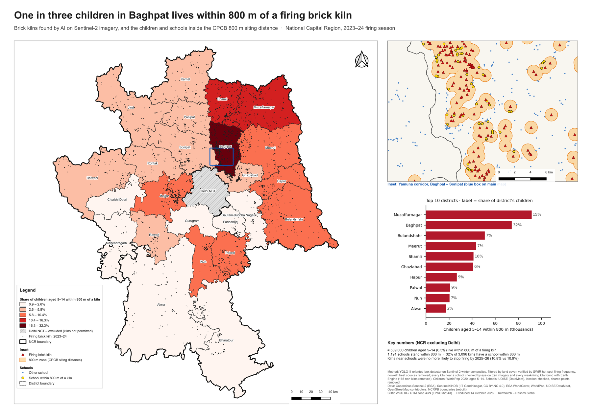
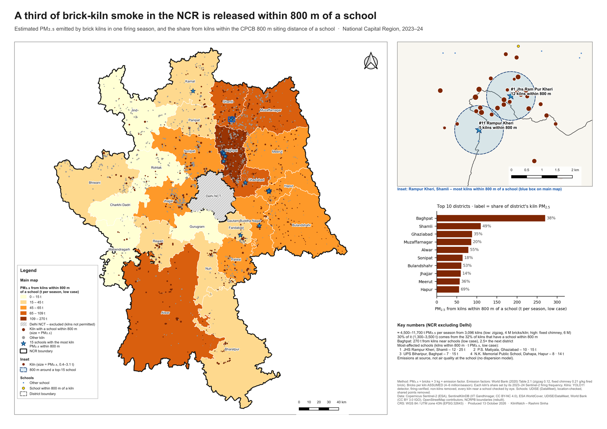
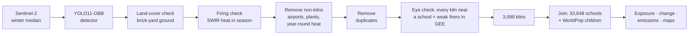

# KilnWatch — brick kilns and schoolchildren in Delhi-NCR

**About 539,000 children aged 5–14 live within 800 m of a firing brick kiln in the
National Capital Region.** That is inside the minimum siting distance the Central
Pollution Control Board sets for schools and homes. In **Baghpat it is one child in three**.

This project mapped every firing kiln in the 55,000 km² region from Sentinel-2
imagery with an AI detector, checked each one in four automated ways, then checked
every kiln near a school, and every weak-firing kiln, by eye, and joined the result to schools and children.



**[▶ Open the interactive map](https://rashmi049-clutch.github.io/kilnwatch/webmap/)** — search a district,
click any kiln or school · **Full report (PDF):** [`report/build/ncr_kilns_report.pdf`](report/build/ncr_kilns_report.pdf)

---

## Findings (2023–24 season, NCR excluding Delhi)

| | Result |
|---|---|
| Children aged 5–14 within 800 m of a firing kiln | **≈ 539,000 (6.5%)** |
| Worst district | **Baghpat, 32.3%** of its children |
| Schools within 800 m of a kiln | **1,191** |
| Kilns with a school within 800 m | **32.4%** of 3,096 |
| Kilns that stopped firing by 2025–26 | 10.9%; **no more often near schools** (10.8% vs 10.9%) |
| Kilns near schools still firing in 2025–26 | **896** |
| Firing on air-quality emergency (GRAP III/IV) days | **Yes**; the GRAP schedules do not close kilns |
| PM₂.₅ emitted by kilns, one season | **≈ 4,500–11,700 t** (estimate), about 30% from kilns near schools |

**Hypotheses** were written down before any data was analysed:

| | Hypothesis | Result |
|---|---|---|
| H1 | ≥ 25% of kilns have a school within 800 m | **Confirmed**: 32.4% |
| H2 | The top 3 districts hold > 50% of exposed children | **Rejected**: 40%. Exposure is spread across the region |
| H3 | Enforcement does not target kilns near schools | **Confirmed**: kilns near schools closed no more often |

**What should happen:**
1. Check the 896 kilns still firing near schools against their consent-to-operate
   records, starting with Baghpat, Shamli and Muzaffarnagar.
2. Consider adding kilns to the GRAP Stage III/IV closure list, as stone crushers
   and mines already are.
3. Put PM₂.₅ monitors at the most-affected schools. JHS Rampur Kheri in Shamli
   has 12 kilns within 800 m.
4. Fix the school register: about 3,100 NCR schools share a point with schools
   from other villages.



---

## How it works



- **Detection.** A YOLO11n oriented-box detector, trained on
  [SentinelKilnDB](https://huggingface.co/datasets/SustainabilityLabIITGN/SentinelKilnDB)
  in a ring *around* the NCR so the NCR stays a true test area. It was run over
  630 tiles of 10 m imagery.
- **Firing check.** A kiln burns, a field doesn't. The normalised hot-spot index
  NHI = (B12 − B11)/(B12 + B11) > 0 flags heat in Sentinel-2's shortwave infrared.
  A detection is kept if it is hot in at least 12% of clear scenes. That threshold
  was read off the distributions of known kilns and random points, not assumed.
- **Not everything that burns is a kiln.** An "active kiln" turned up inside Delhi
  airport, so a check was added: heat during the monsoon (when kilns are shut) or
  location inside a mapped facility (OpenStreetMap) removed 157 non-kilns.
- **Exposure.** Children aged 5–14 from WorldPop are counted inside the union of
  800 m buffers, so overlapping zones count each child once. School points from
  UDISE were checked: points whose district didn't match their location, or that
  lay far from any buildings, were dropped, and so were 3,090 points shared by
  schools from different villages (default coordinates, not school locations).
- **Change.** Each kiln is re-tested *at the same spot* in 2025–26, so detector
  misses can't pose as closures.

## How far to trust it

| Check | Result |
|---|---|
| Every kiln within 800 m of a school (1,133), checked by eye on Esri imagery; older captures for hazy ones | **101 non-kilns removed** (parks, stadiums, yards, factories) |
| Earth Engine heat record, 3 seasons: kilns away from schools firing in < 8 dry-season months (218), checked by eye | **65 more non-kilns removed** (fields, drying yards, quarries) |
| Audit 1 by Rashmi Sinha: 25 random kilns, whole layer before cleaning, Google Earth history | **Precision 0.91** (95% CI 0.73–0.98) |
| Audit 2 by Rashmi Sinha: 30 random kilns from the 1,904 not checked by eye, Google Earth history | **29 / 29 working kilns** (95% CI 0.88–1.00) |
| Independent re-count of exposure in QGIS | Identical to the code (415 / 174 / 263) |
| Firing calendar | Matches the known season: relight Oct–Nov, peak Feb–May, monsoon shutdown |
| Sentinel-2C replaced 2A in Jan 2025 | Background heat at control points flat across the switch |
| Boundary areas vs official figures | NCR −0.12%, Alwar −0.30%, Bharatpur −0.14% |

**Limitations.**
- Counts are *at least* figures: the detector misses some kilns (recall about 0.62).
- Children are counted where they *live* (a modelled estimate); school enrolment
  wasn't available.
- The emissions figure rests on an *assumed* production per kiln. It measures
  smoke released at the kiln, not air quality at the school.

## Methods that were tested and rejected

Each is kept in the code and documented in the report.

- **Fine-tuning the detector on this study's own imagery.** F1 fell rather than rose.
- **Blind visual review of detections.** At basemap resolution it measured the
  reviewer, not the map. It was replaced by the firing check.
- **Per-kiln test of emergency days.** Kilns photographed on the same day share
  that day's haze, so the real sample was about 23 days, not 3,290 kilns. The first
  confidence interval was 25 times too narrow. Redone with days as the unit, the
  test is inconclusive.
- **Correcting the closure rate for the firing test's miss rate.** It gave a
  negative rate, which showed the correction was wrong.
- **Trusting automated checks alone near schools.** A full eye check found 9% of
  near-school "kilns" were town sites, and they look like closures. Cleaning only the
  near-school group produced a borderline "finding" (p = 0.06) that vanished once
  the far group was checked too: a comparison is only as fair as the checking of both groups.

## Repository

```
analysis/        all processing scripts (one per step, each with a docstring)
docs/webmap/     interactive Leaflet map (build_webmap.py → index.html)
docs/plan.html   project plan with status of every step
outputs/maps/    finished A3 maps (PNG, PDF) and their GeoPackage layers
outputs/tables/  every number in the report, as CSV
qgis/            QGIS project with both print layouts
report/          LaTeX report (source) and PDF
models/          trained detector weights
```

## Reproducing

```bash
pip install -r requirements.txt
earthengine authenticate
```

Main pipeline, in order: `fetch_ncr_boundary` → `prepare_ncr_boundary` →
`prepare_schools` → `school_builtup_check` → `prepare_training` → `train_detector`
→ `fetch_s2_tiles` → `scan_ncr` → `landcover_filter` → `firing_verify` →
`monsoon_heat` → `heat_source_check` → `nonkiln_flag` → `dedupe_kilns` →
`apply_visual_check` → `exposure` → `exposure_excl_delhi` → `kiln_change` → `h3_stop_near_schools` → `monthly_firing` →
`grap_firing_daily` → `emissions` → `map_exposure_data`. The report is built
with `python report/build_report.py`.

Raw data (imagery tiles, SentinelKilnDB, school points) is not in the repository.
The scripts download it. `scan_ncr.py` and `evaluate_ncr.py` need GDAL; run them
with QGIS's Python.

## Data and licences

| Data | Source | Licence |
|---|---|---|
| Sentinel-2 L2A | Copernicus / ESA, via Google Earth Engine | Copernicus free licence |
| SentinelKilnDB (training labels) | IIT Gandhinagar Sustainability Lab | CC BY-NC 4.0 |
| ESA WorldCover 2021 | ESA | CC BY 4.0 |
| WorldPop 2020 age–sex | WorldPop, University of Southampton | CC BY 4.0 |
| School locations | NIC SchoolGIS via [datameet/udise_schools](https://github.com/datameet/udise_schools) | Not stated |
| Boundaries, facilities | OpenStreetMap contributors; geoBoundaries | ODbL; CC BY 4.0 |
| Emission factors | World Bank (2020), *Dirty Stacks, High Stakes*, Table 2.1 | CC BY 3.0 IGO |
| Siting rules, GRAP | CPCB (2022); CAQM orders | Government publications |

The detector was trained on CC BY-NC data, so the kiln layers here are for
**non-commercial use**.

---

<sub>Working copies (private Claude artifacts): [project plan](https://claude.ai/artifact/UCmGDTvHBQktn2okGH3uDA) · [web map draft](https://claude.ai/artifact/RG48cSJJLW8tCXFSJkQ98m)</sub>

**Rashmi Sinha** · GIS analyst · CRS throughout: WGS 84 / UTM 43N (EPSG:32643) · October 2026
